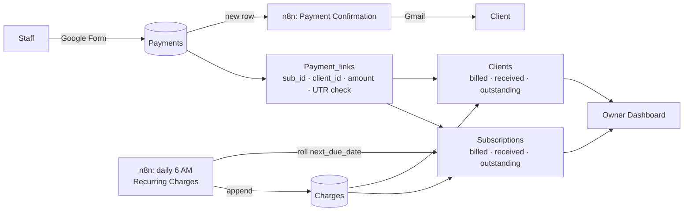

# Client Payment Tracker

**A low-cost billing, collections and payment-control system for small service businesses — built on Google Sheets, Google Forms and self-hosted n8n.**

Built for businesses that provide a service first and collect payment later — accounting and tax practices, agencies, consultants, clinics, maintenance and AMC providers, coaching institutes — and that have outgrown a spreadsheet but don't need (or can't justify) a full ERP or accounting suite.

> The design came from a real request posted by a small professional-services owner managing 200+ clients and 10+ services on spreadsheets. Their non-negotiable requirement: *staff must be able to record a payment without seeing what any client is charged, what they owe, or what the business earns.*

## 📺 Demo video

[](https://youtu.be/ikGRrKMLUP4)

Watch the full walkthrough: automatic monthly billing in n8n, double-billing protection, staff logging a payment through the form, balances updating instantly, the client's automatic receipt email, and the owner dashboard. [▶ Watch on YouTube](https://youtu.be/ikGRrKMLUP4)

---

## The business problem

| Pain in a spreadsheet-run business | Consequence |
|---|---|
| Fees are tracked by hand; monthly and yearly services must be re-billed manually | Missed or late billing, revenue leakage |
| Partial and multiple payments across cash, bank and UPI | Nobody is sure what a client really owes |
| Staff who collect payments can see every fee and the business's total revenue | Confidentiality and trust problem |
| Anyone with the sheet can edit or delete past entries | No reliable record; errors and fraud go unnoticed |
| The same bank/UPI reference gets entered twice | Overstated collections, reconciliation headaches |
| Clients ask "did you get my payment?" | Time lost on calls; weaker client trust |
| The owner has no single view of billed vs collected vs outstanding | Cash-flow decisions are made blind |

---

## Business functions it covers

### 1. Client & service master
One place for every client, the services they take, the agreed fee and the billing cycle (monthly, yearly, one-time). A client can hold several services, each tracked separately.

### 2. Automated recurring billing
An n8n workflow runs every morning, finds every service whose due date has arrived, adds the charge to the ledger and rolls the next due date forward. One-time services are billed once and closed automatically. **No one has to remember to bill.**

### 3. Payment capture with segregation of duties
Staff record payments through a simple form — service, date, mode (cash / bank / UPI), amount, UTR/reference. **They never get access to the spreadsheet**, so they cannot see fees, balances, other clients or business revenue. The owner sees everything.

### 4. Accounts receivable, calculated automatically
Every charge and every payment flows into running totals: billed, received and outstanding — per service and per client. Partial payments and multiple instalments are handled naturally.

### 5. Reconciliation support
Every payment carries its mode and UTR/reference, so bank and UPI receipts can be matched to statements. **Duplicate references are flagged automatically** on the dashboard.

### 6. Client communication
When a payment is recorded, the client receives an automatic confirmation email showing the amount, date, mode, reference and their remaining balance for that service — and nothing else.

### 7. Owner dashboard
Total billed, received and outstanding; this month's billing vs collections; collections by cash / bank / UPI; collection rate; clients with dues; duplicate references to review; outstanding by client.

### 8. Audit trail
Every payment is timestamped and tied to the verified Google account of the staff member who entered it. Payment rows are never edited: corrections are recorded as new reversal entries with a reason, preserving the full history.

---

## Controls built in

Designed with governance in mind — the same principles used in information-security and compliance frameworks, applied at small-business scale:

| Control | How it's implemented |
|---|---|
| **Least privilege** | Staff only ever see the payment form, never the ledger |
| **Segregation of duties** | Staff record payments; only the owner manages fees, clients and billing |
| **Accountability** | Verified email captured on every entry; timestamp on every record |
| **Integrity / append-only records** | Payments are corrected with reversal entries, not edits or deletions |
| **Idempotent automation** | Each charge has a deterministic ID (`CH-<sub_id>-<due date>`) plus a dedupe step, so a re-run can never double-bill |
| **Data minimisation** | Client emails disclose only the balance for the service paid — no other client or business data |
| **Monitoring** | Any failed automation run triggers an email alert |

---

## How it works



### Data model
| Tab | Purpose |
|---|---|
| **Clients** | Client master + per-client totals |
| **Services** | Service catalogue and billing cycle |
| **Subscriptions** | Which client takes which service, at what fee, next due date; per-service totals |
| **Charges** | Ledger of every amount billed (appended by n8n) |
| **Payments** | Written only by the Google Form |
| **Payment_links** | Helper formulas that map each payment to its subscription/client and flag duplicate UTRs (kept off the form tab on purpose) |
| **Dashboard** | Owner's view |

### Automations (n8n)
| Workflow | Trigger | What it does |
|---|---|---|
| **Recurring Charges** | Daily, 6:00 AM IST | Filter due subscriptions → build charge (deterministic ID, amount, period) → dedupe → append to Charges → roll `next_due_date` (or close one-time services) |
| **Payment Confirmation** | New row in Payments | Parse payment → wait for formulas → look up subscription and client → send HTML confirmation email |
| **Error alerts** | Any workflow failure | Emails the owner with workflow, node and error |

---

## Results from the live test

- On **1 October 2026** the recurring-charges workflow ran unattended and billed exactly the four services due — no duplicates, correct amounts, next due dates rolled to 1 November.
- Payments recorded through the form updated every balance and the dashboard instantly, and each triggered a correctly addressed confirmation email.

---

## Repository contents

```
.
├── README.md
├── template/
│   └── client-payment-tracker-template.xlsx   # full sheet structure with fictitious sample data
├── workflows/                                  # n8n workflow exports (credentials removed)
│   └── README.md
└── docs/
    ├── SETUP.md            # step-by-step build guide
    ├── LESSONS-LEARNED.md  # every problem hit during the build and its fix
    └── roadmap.xlsx        # feature roadmap and status
```

## Stack
Google Sheets · Google Forms · n8n Community Edition (self-hosted in Docker) · Gmail · Google Cloud OAuth

**Running cost:** ₹0 beyond existing Google accounts and the machine running n8n.

## Roadmap
- **Phase 1 — Core system** ✅ form, balances, dashboard, recurring billing, double-billing guard, duplicate-UTR check, confirmation email
- **Phase 2 — Collections** ⏳ overdue reminders (3/7/15 days), ageing report (0–30/31–60/61–90/90+), monthly client statements, daily owner summary
- **Phase 3 — Trust layer** ⏳ month-end lock, change log, access review, automated backups, data-protection (DPDP Act) note

See [`docs/roadmap.xlsx`](docs/roadmap.xlsx).

## Limitations
- A Sheets-based system — ideal for hundreds of clients and a handful of staff, not thousands.
- The owner can still edit the sheet; Google Sheets version history is the backstop.
- Not an accounting or GST system — invoices and tax compliance stay with the business's accountant.

---

*Built by Mitchell Swapnil Chatterjee ([@miky21x21](https://github.com/miky21x21)). All client names, phone numbers and emails in this repository are fictitious.*
